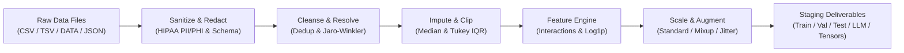

# Health Informatics Dataset Management & Profiling Toolkit

A modular Python toolkit developed for data acquisition, batch ingestion, and automated exploratory data analysis (EDA) / dataset profiling. Built entirely with the Python Standard Library (zero external dependencies required).

---

## Table of Contents

1. [Automated Data Profiler & EDA Tool (`data_profiler.py`)](#1-automated-data-profiler--eda-tool-dataprofilerpy)
   - [Overview](#overview)
   - [Analytical Capabilities](#analytical-capabilities)
   - [Usage & Command-Line Interface](#usage--command-line-interface)
   - [Domain Presets & Headerless Data](#domain-presets--headerless-data)
   - [Generated Deliverables & Reports](#generated-deliverables--reports)
   - [Sample Console Report](#sample-console-report)
2. [Dataset Batch Copy Utility (`copy_file.py`)](#2-dataset-batch-copy-utility-copyfilepy)
   - [Overview](#overview-1)
   - [Configuration (`.env`)](#configuration-env)
   - [Key Features](#key-features)
   - [Logging Configuration](#logging-configuration)
3. [AI Data Preparation, Curation & Staging Pipeline (`data_curator.py`)](#3-ai-data-preparation-curation--staging-pipeline-datacuratorpy)
   - [Overview](#overview-2)
   - [End-to-End Pipeline Stages](#end-to-end-pipeline-stages)
   - [AI Staging Deliverables](#ai-staging-deliverables)
   - [CLI Commands & Usage Examples](#cli-commands--usage-examples)
   - [Command-Line Argument Reference](#command-line-argument-reference)
4. [Repository File Inventory](#4-repository-file-inventory)

---

## 1. Automated Data Profiler & EDA Tool (`data_profiler.py`)

### Overview

[`data_profiler.py`](file:///home/kafeiaulait/HI-634-Assign_1/data_profiler.py) is a zero-dependency Python script designed to profile, inspect, and statistically summarize tabular datasets. It can ingest local files (CSV, TSV, DATA, TXT, JSON, JSON Lines) or download datasets directly from remote URLs.

### Analytical Capabilities

| Category | What Is Checked & Reported |
| :--- | :--- |
| **Dimensions & Metadata** | Row count, column count, raw file size on disk/download, and provenance source URL. |
| **Schema & Data Types** | Inferred column types: `Integer`, `Float`, `Boolean`, `Datetime`, `Categorical`, `Text`, and `Primary Key / ID Candidates`. |
| **Data Hygiene & Quality** | Missing values count & % (recognizes custom missing markers like `?`, `NA`, `null`, `None`, `-9`, `-999`, `.`), exact duplicate row counts, zero-variance (constant) columns, and an overall **Dataset Health Score (0–100)**. |
| **Statistical Summaries** | **Numeric:** Mean, Std Dev, Variance, Min, 25% (Q1), Median (50%), 75% (Q3), Max, IQR, Fisher-Pearson Skewness, Outlier counts (via Tukey's $1.5 \times IQR$ method), and Zero-inflation (%).<br>**Categorical:** Cardinality (distinct count), top 5 most frequent values with percentage frequencies, and majority class dominance ratio. |
| **Noticeable Trends** | **Bivariate Correlations:** Pearson correlation matrix flagging strong positive ($r \ge +0.7$) and negative ($r \le -0.7$) relationships.<br>**Distribution Shapes:** Highlights heavy right/left skewness ($|\text{skew}| \ge 1.5$) and zero-inflated variables.<br>**Temporal Trends:** Minimum date, maximum date, and total observed timespan if datetime columns exist.<br>**Class Imbalances:** Flags categorical variables where a single class represents $\ge 85\%$ of observations. |
| **Actionable Recommendations** | Automated checklist highlighting columns needing imputation, duplicate removal, columns to drop due to lack of variance, multicollinear features, and candidate target/ID variables. |
| **Batch Multi-File Comparison** | When multiple files are analyzed together, it generates a **Multi-Dataset Comparative Summary Table** comparing row counts, missingness, duplicates, and health scores across all files. |

---

### Usage & Command-Line Interface

#### 1. Analyze a local file and record its provenance Source URL
```bash
python3 data_profiler.py myfile.csv --source-url "https://archive.ics.uci.edu/dataset/45/heart+disease"
```

#### 2. Download and analyze directly from a remote URL
```bash
python3 data_profiler.py --url "https://raw.githubusercontent.com/mwaskom/seaborn-data/master/iris.csv"
```

#### 3. Analyze multiple files or an entire directory in batch
```bash
# Profile all supported data files in a folder
python3 data_profiler.py source_dir/

# Profile specific files together (generates side-by-side comparison table)
python3 data_profiler.py cleveland.data hungarian.data switzerland.data va.data --uci-heart
```

#### 4. Save JSON machine-readable metrics alongside Markdown
```bash
python3 data_profiler.py dataset.csv --json
```

#### 5. Interactive prompt & `.env` fallback
If invoked with no arguments:
```bash
python3 data_profiler.py
```
The script will check `.env` for `DATA_FILES`, `SOURCE_FILES`, or `SOURCE_FOLDER` definitions, or interactively prompt for the file path and optional source URL.

---

### Domain Presets & Headerless Data

Many research datasets (such as UCI `.data` files) do not include column headers. The profiler provides custom naming options and domain-specific presets:

- **Custom column names via CLI:**
  ```bash
  python3 data_profiler.py data.txt --columns "age,sex,cp,trestbps,chol,fbs,restecg,thalach,exang,oldpeak,slope,ca,thal,num"
  ```
- **Built-in UCI Heart Disease preset (`--uci-heart`):**
  Applies the 14 standard attributes (`age`, `sex`, `cp`, `trestbps`, `chol`, `fbs`, `restecg`, `thalach`, `exang`, `oldpeak`, `slope`, `ca`, `thal`, `num`).
  ```bash
  python3 data_profiler.py processed.cleveland.data --uci-heart
  ```
- **Automatic `.names` file discovery:**
  If a corresponding `<dataset>.names` file is in the same directory, the profiler automatically parses attribute names if custom columns are not explicitly supplied.

---

### Generated Deliverables & Reports

For every analyzed dataset, the tool creates:
1. **Interactive Console Summary**: ASCII tables and formatted terminal outputs with immediate alerts.
2. **Markdown Profile Report (`<filename>_profile_report.md`)**: A complete, self-contained GitHub-Flavored Markdown report formatted with executive summaries, data schema tables, distribution breakdowns, correlation lists, and cleaning checklists.
3. **Optional JSON Summary (`<filename>_profile.json`)**: Emitted when passing `--json` for ingestion into automated downstream pipelines.

---

### Sample Console Report

```text
================================================================================
 DATASET EXPLORATION & PROFILE REPORT: test_sample.csv
================================================================================
 Source URL       : https://archive.ics.uci.edu/dataset/45/heart+disease
 Local File Path  : /home/kafeiaulait/HI-634-Assign_1/test_sample.csv
 File Size        : 598 B
 Total Rows       : 11
 Total Columns    : 10
 Duplicate Rows   : 1 (9.09%)
 Missing Cells    : 1 / 110 (0.91%)
 Health Score     : 96.9/100.0
--------------------------------------------------------------------------------

[1] COLUMN SCHEMA & DATA HYGIENE
#   Column Name            Data Type     Missing (%)     Distinct   Flags / Special   
-------------------------------------------------------------------------------------
1   patient_id             Categorical   0     (  0.0%) 10         -                 
2   age                    Integer       0     (  0.0%) 10         -                 
3   gender                 Categorical   0     (  0.0%) 2          -                 
4   cholesterol            Integer       0     (  0.0%) 10         1 OUTLIERS        
5   resting_bp             Integer       0     (  0.0%) 10         -                 
6   fasting_bs             Boolean       1     (  9.1%) 2          -                 
7   max_heart_rate         Integer       0     (  0.0%) 10         -                 
8   exercise_angina        Boolean       0     (  0.0%) 2          -                 
9   diagnosis              Boolean       0     (  0.0%) 2          -                 
10  recorded_date          Datetime      0     (  0.0%) 10         -                 

[2] NUMERICAL STATISTICAL SUMMARY
Column             Mean       Std        Min       25%       Median    75%       Max       Skew     Outliers 
------------------------------------------------------------------------------------------------------
age                55.36      8.12       41.00     48.00     58.00     61.00     67.00     -0.47    0        
cholesterol        272.73     89.84      190.00    210.00    260.00    280.00    520.00    2.35     1        
resting_bp         134.82     13.42      118.00    122.00    135.00    142.00    160.00    0.45     0        
max_heart_rate     142.73     19.79      110.00    130.00    140.00    160.00    172.00    -0.10    0        

[3] CATEGORICAL & TEXT FEATURE PROFILES
 • patient_id         [Distinct: 10  | Dominant: 18.2%] -> Top: 'P010' (2), 'P001' (1), 'P002' (1), 'P003' (1)
 • gender             [Distinct: 2   | Dominant: 63.6%] -> Top: 'Male' (7), 'Female' (4)
 • fasting_bs         [Distinct: 2   | Dominant: 80.0%] -> Top: '0' (8), '1' (2)
 • exercise_angina    [Distinct: 2   | Dominant: 54.5%] -> Top: 'Yes' (6), 'No' (5)
 • diagnosis          [Distinct: 2   | Dominant: 54.5%] -> Top: '1' (6), '0' (5)

[4] NOTICEABLE TRENDS & CORRELATIONS
 • Top Bivariate Correlations:
   📉 resting_bp <---> max_heart_rate: r = -0.987 (Strong Negative)
   📉 age <---> max_heart_rate: r = -0.892 (Strong Negative)
   📈 cholesterol <---> resting_bp: r = +0.879 (Strong Positive)
   📈 age <---> resting_bp: r = +0.839 (Strong Positive)
 • Temporal Range (recorded_date): 2023-01-15T00:00:00 to 2023-01-24T00:00:00 (Timespan: 9 days)

[5] FIRST-REVIEW RECOMMENDATIONS & ACTION ITEMS
 ⚠️ Duplicate Rows Detected: Found 1 exact duplicate row(s) (9.1%). Consider deduping with .drop_duplicates().
 💡 Outlier Hotspots: Columns ['cholesterol'] exhibit >= 5% Tukey outliers. Inspect whether these represent clinical anomalies or entry errors.
 💡 Heavy Skewness: Features ['cholesterol'] are heavily skewed (|skew| >= 1.5). Consider applying Log or Power transformations.
 ⚠️ Multicollinearity Alert: Very strong correlations found: resting_bp & max_heart_rate (r=-0.99), age & max_heart_rate (r=-0.89). Consider feature selection or PCA to avoid redundant predictors.
================================================================================
```

---

## 2. Dataset Batch Copy Utility (`copy_file.py`)

### Overview

[`copy_file.py`](file:///home/kafeiaulait/HI-634-Assign_1/copy_file.py) traverses a source folder and copies dataset files to a target destination using [`.env`](file:///home/kafeiaulait/HI-634-Assign_1/.env) settings. It supports semicolon-separated file lists, automatic filtering for `.data` extensions, optional batch renaming, interactive overwrite protection with exception handling, and file-based logging.

### Configuration (`.env`)

```ini
# Relative paths from script root
SOURCE_FOLDER=../source_datafiles/heart+disease
TARGET_FOLDER=../project/data/raw

# Semicolon-separated list of files (or *.data for all .data files)
SOURCE_FILES=processed.cleveland.data; processed.hungarian.data; processed.switzerland.data; processed.va.data

# Rename flag: Y to rename in target, N to keep original names
RENAME_FILE=N

# Semicolon-separated target names (only used if RENAME_FILE=Y)
TARGET_FILES=cleveland.data; hungarian.data; switzerland.data; va.data
```

### Key Features

1. **File Logging**: Logs script execution timestamps, path resolutions, skipped files, overwrite decisions, exceptions, and summary statistics to [`dataset_copy.log`](file:///home/kafeiaulait/HI-634-Assign_1/dataset_copy.log).
2. **Relative Paths**: Automatically resolves paths relative to the script's directory, making it drive- and platform-independent.
3. **Semicolon-Separated File List**: Allows specifying multiple files in `SOURCE_FILES` separated by `;`.
4. **`.data` Extension Filter**: Only files ending with `.data` are processed. Files with other extensions (e.g. `heart-disease.names` or `.txt`) are safely skipped with a notice and logged.
5. **Folder Traversal**: Checks direct paths and searches subfolders for any listed files.
6. **Interactive Overwrite Protection**: Prompts `Do you want to overwrite it? (Y/N): ` when a target file exists. Declining raises a `FileExistsError` caught by a `try..except` block without aborting the batch.
7. **Optional Batch Renaming**: When `RENAME_FILE=Y`, maps source files to `TARGET_FILES` 1-to-1.

### Logging Configuration

The log filename is defined as a constant in [`copy_file.py`](file:///home/kafeiaulait/HI-634-Assign_1/copy_file.py):
```python
LOG_FILE_NAME = "dataset_copy.log"
```

---

## 3. AI Data Preparation, Curation & Staging Pipeline (`data_curator.py`)

### Overview

[`data_curator.py`](file:///home/kafeiaulait/HI-634-Assign_1/data_curator.py) is an enterprise-grade, zero-external-dependency Python pipeline that ingests raw dataset files, sanitizes and cleanses dirty records, performs feature engineering and normalization, resolves duplicate entities, augments underrepresented samples, and stages multi-modal deliverables ready for AI/ML training, LLM fine-tuning, RAG ingestion, and model evaluation.

Built entirely on the Python 3.8+ Standard Library, it guarantees **Zero Data Leakage** by fitting all scalers, median imputers, and categorical vocabularies strictly on the training partition before transforming validation and test partitions.



---

### End-to-End Pipeline Stages

| Pipeline Stage | Algorithmic Mechanism & Implementation Details |
| :--- | :--- |
| **1. Multi-source Ingestion** | Ingests CSV, TSV, DATA (UCI format), TXT, JSON, and JSON Lines. Automatically sniffs delimiters (`,` `\t` `;` `|` whitespace) and supports headerless domain presets like UCI Heart Disease (`--uci-heart`). |
| **2. HIPAA PII/PHI Redaction** | Redacts direct identifiers (SSNs, emails, phone numbers, IP addresses, Medical Record Numbers) and provides cryptographically salted SHA-256 pseudonymization for patient/subject identifiers. |
| **3. Exact & Key Deduplication** | Removes exact duplicate rows across all features or on user-specified primary keys (`--dedup-keys`), recording drops in audit logs. |
| **4. Entity Resolution & Linkage** | Employs pure-Python **Jaro-Winkler** and normalized **Levenshtein** string similarity with blocking passes to resolve duplicate entities with minor spelling discrepancies (e.g. patients) and assign unified `canonical_entity_id` clusters. |
| **5. Missing Value Sanitization** | Drops columns with excessive missingness (>50%) and uninformative rows (>60% missing). Imputes numerical values using median, mean, mode, or constant 0; imputes categoricals using mode; and creates informative binary missingness flags (`col_is_missing`). |
| **6. Outlier Detection & Avoidance** | Identifies anomalies via **Tukey's IQR method** ($[Q_1 - 1.5 \times IQR, Q_3 + 1.5 \times IQR]$), Z-score ($|Z| > 3.0$), or Median Absolute Deviation (MAD). Avoids outlier corruption through **Winsorization / clipping** (default), trimming, median replacement, or indicator flagging (`col_is_outlier`). |
| **7. Feature Engineering** | Automatically generates clinical interaction terms (ratios like blood pressure / cholesterol, and products), non-linear $\ln(1+x)$ transformations for skewed variables ($|\text{skew}| \ge 1.5$), datetime decompositions (`year`, `month`, `day`, `dayofweek`, `is_weekend`), and low-cardinality One-Hot Encoding (`col_category`). |
| **8. Normalization & Scaling** | Features are scaled using `StandardScaler` (Z-score: mean 0, variance 1), `MinMaxScaler` ($[0, 1]$), `RobustScaler` (Median/IQR), or `MaxAbsScaler`. All parameters are serialized to [`scaler_parameters.json`](file:///home/kafeiaulait/HI-634-Assign_1/staged_data/scaler_parameters.json) to eliminate test leakage. |
| **9. Tabular Data Augmentation** | Augments underrepresented data using Gaussian jittering ($x + \mathcal{N}(0, (0.05 \cdot \sigma)^2)$), Tabular Mixup (convex combinations: $\lambda x_1 + (1-\lambda) x_2$), or minority class balancing with `is_synthetic` flags. |
| **10. Zero-Leakage AI Staging** | Partitions data into stratified Train, Validation, and Test splits. Fits all statistics **strictly on training rows** before propagating to validation and test splits. |

---

### AI Staging Deliverables

Every curation run generates an AI-ready staging folder:

1. **[`train.csv`](file:///home/kafeiaulait/HI-634-Assign_1/staged_data/train.csv), [`val.csv`](file:///home/kafeiaulait/HI-634-Assign_1/staged_data/val.csv), [`test.csv`](file:///home/kafeiaulait/HI-634-Assign_1/staged_data/test.csv):** Curated tabular splits ready for XGBoost, LightGBM, Random Forests, or Scikit-Learn.
2. **[`curated_full.csv`](file:///home/kafeiaulait/HI-634-Assign_1/staged_data/curated_full.csv):** Complete consolidated and curated dataset across all partitions.
3. **[`staged_for_llm.jsonl`](file:///home/kafeiaulait/HI-634-Assign_1/staged_data/staged_for_llm.jsonl):** Structured natural language patient narratives for instruction-tuning, medical LLMs, or RAG embeddings (`{"text": "Clinical Record Profile: age is 58...", "target": 1, "metadata": {...}}`).
4. **[`staged_tensors.json`](file:///home/kafeiaulait/HI-634-Assign_1/staged_data/staged_tensors.json):** Numeric feature matrix $X$ and target vector $y$ formatted for direct PyTorch `DataLoader` or TensorFlow `tf.data` pipelines.
5. **[`scaler_parameters.json`](file:///home/kafeiaulait/HI-634-Assign_1/staged_data/scaler_parameters.json):** Serialized means, standard deviations, and boundaries for real-time inference serving.
6. **[`staging_manifest.json`](file:///home/kafeiaulait/HI-634-Assign_1/staged_data/staging_manifest.json):** Cryptographic SHA-256 provenance hashes, record counts, and pipeline execution logs.
7. **[`DATA_CARD.md`](file:///home/kafeiaulait/HI-634-Assign_1/staged_data/DATA_CARD.md):** Formal Model Governance Data Card with Mermaid pipeline diagrams and statistical audits.

---

### CLI Commands & Usage Examples

#### 1. Curate all files in a source directory with UCI Heart Disease preset
```bash
python3 data_curator.py source_dir/ --uci-heart --output-dir staged_data/
```

#### 2. Curate specific dataset files with target stratification and class balancing
```bash
python3 data_curator.py cleveland.data hungarian.data --target-col num --augment balance --output-dir staged_data/
```

#### 3. Curate clinical patient records with PII redaction and fuzzy entity resolution
```bash
python3 data_curator.py patients.csv --entity-keys "full_name" --dedup-keys "patient_id" --phi-redact --scale-method standard
```

#### 4. Run automated test suite
```bash
python3 test_data_curator.py
```

---

### Command-Line Argument Reference

| Flag | Default | Description |
| :--- | :--- | :--- |
| `targets` | `None` | Path(s) to dataset file(s) or a folder containing dataset files. |
| `--folder` | `None` | Directory containing dataset files to curate in batch. |
| `--files` | `None` | Semicolon-separated list of filenames (e.g. `'cleveland.data; va.data'`). |
| `--output-dir`, `-o` | `staged_data` | Directory where staged AI deliverables and reports will be saved. |
| `--target-col` | `None` | Target label column for stratified train/val/test splits and class balancing. |
| `--columns` | `None` | Comma-separated list of column names for headerless files. |
| `--uci-heart` | `False` | Applies the standard 14 UCI Heart Disease attribute preset. |
| `--dedup-keys` | `None` | Comma-separated columns for subset/primary-key deduplication. |
| `--entity-keys` | `None` | Comma-separated columns for fuzzy Jaro-Winkler entity linkage. |
| `--impute-numeric` | `median` | Numerical imputation strategy: `median`, `mean`, `mode`, `zero`, or `none`. |
| `--impute-categorical` | `mode` | Categorical imputation strategy: `mode`, `missing`, or `none`. |
| `--outlier-treatment` | `clip` | Outlier handling: `clip` (Winsorize), `drop`, `impute`, `flag`, or `none`. |
| `--outlier-factor` | `1.5` | Tukey IQR fence multiplier (1.5 for standard, 3.0 for extreme). |
| `--scale-method` | `standard` | Scaling method: `standard` (Z-score), `minmax`, `robust`, `maxabs`, or `none`. |
| `--augment` | `jitter` | Augmentation method: `jitter` (Gaussian), `mixup` (convex), `balance`, `none`. |
| `--augment-ratio` | `0.20` | Ratio of synthetic samples to generate relative to train set (e.g. `0.20` = +20%). |
| `--split-ratios` | `0.70 0.15 0.15` | Train / Validation / Test partition ratios. |
| `--phi-redact` | `True` | Redacts HIPAA direct identifiers (SSNs, emails, phone numbers, IPs, MRNs). |
| `--no-llm-format` | `False` | Skips generating `staged_for_llm.jsonl` natural language prompts. |

---

## 4. Repository File Inventory

- [`data_curator.py`](file:///home/kafeiaulait/HI-634-Assign_1/data_curator.py): Universal AI data preparation, sanitization, curation, scaling, and multi-modal staging pipeline.
- [`test_data_curator.py`](file:///home/kafeiaulait/HI-634-Assign_1/test_data_curator.py): Zero-dependency unit and integration test suite for the curation pipeline.
- [`data_profiler.py`](file:///home/kafeiaulait/HI-634-Assign_1/data_profiler.py): Automated exploratory data analysis, data hygiene, and statistical profiling tool.
- [`copy_file.py`](file:///home/kafeiaulait/HI-634-Assign_1/copy_file.py): Batch file copying and renaming utility with overwrite protection.
- [`.env`](file:///home/kafeiaulait/HI-634-Assign_1/.env): Active configuration file.
- [`.env.example`](file:///home/kafeiaulait/HI-634-Assign_1/.env.example): Template configuration file.
- [`source_dir/`](file:///home/kafeiaulait/HI-634-Assign_1/source_dir): Default source directory for raw files.
- [`staged_data/`](file:///home/kafeiaulait/HI-634-Assign_1/staged_data): Default destination directory for curated AI deliverables.
