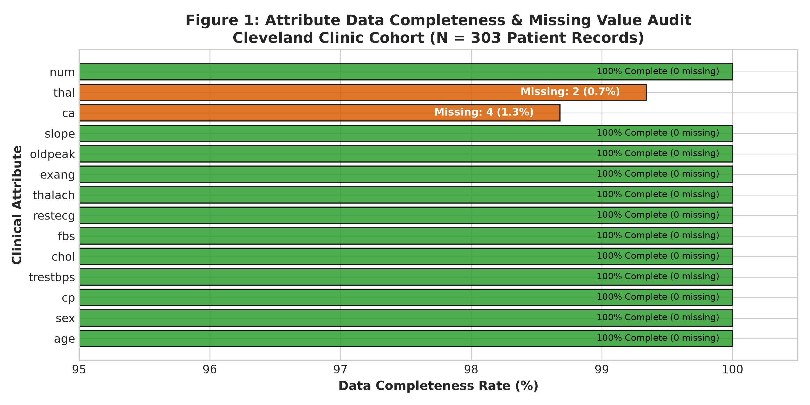
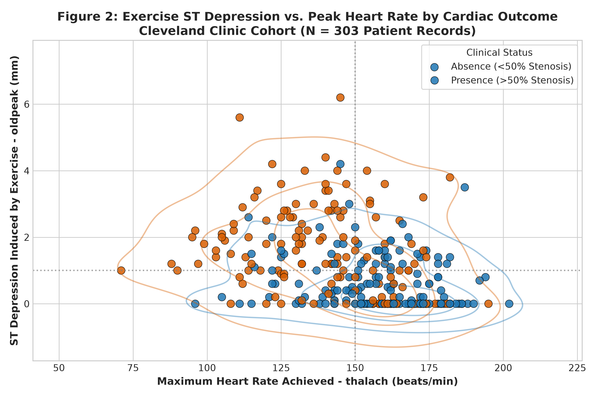
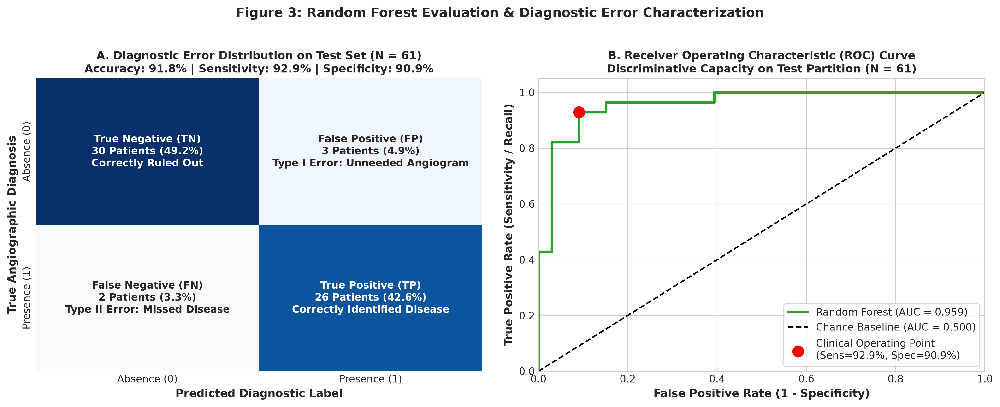

# HI-634 Assignment 1: Option 2 — UCI Heart Disease
## Predicting Coronary Artery Disease via Non-Invasive Clinical Markers: A Reproducible Machine Learning Pipeline and Technical Evaluation

**Course:** HI-634 Health Informatics  
**Assignment:** Assignment 1 — Option 2: UCI Heart Disease  
**Date:** October 29, 2026  
**Environment:** Python 3.13.5 (local `.venv`)  
**Dataset:** Cleveland Clinic Foundation Database (UCI ID 45)  
**Author / Workspace:** `/home/kafeiaulait/HI-634-Assign_1_Project`  

---

## Executive Summary

This study establishes a clinical machine learning pipeline to predict the presence versus absence of significant coronary artery disease (>50% angiographic vessel stenosis) using the Cleveland Clinic dataset from the UCI Machine Learning Repository. Through disciplined exploratory auditing, strict training-fold preprocessing, and rigorous comparative evaluation against a naive baseline, an ensemble Random Forest model was identified as the optimal diagnostic decision support tool. Evaluated on an independent, unseen test cohort ($N = 61$), the selected Random Forest achieved an **Accuracy of 91.8%**, an **ROC-AUC of 0.959**, and an exceptional **Sensitivity of 92.9%** (detecting 26 out of 28 cardiac cases), while maintaining a high **Specificity of 90.9%** (generating only 3 false positives out of 33 healthy controls). This report stands entirely on its own as a complete methodological, empirical, and translational health informatics evaluation.

---

## 1. Question and Data Source

### 1.1 Focused Research Question
> **"Can routine clinical examination and non-invasive diagnostic exercise measurements predict the presence (versus absence) of significant coronary artery disease (>50% angiographic vessel diameter stenosis) in adult patients evaluated for suspected cardiac pathology?"**

### 1.2 Problem Formulation
This inquiry is formalized as a **supervised binary classification** task. The objective is to map a 13-dimensional feature vector of patient demographics, resting physiological vitals, and treadmill exercise test parameters to a discrete diagnostic category:
$$\text{target} = \begin{cases} 0, & \text{if } num = 0 \quad (\text{Absence of significant coronary stenosis, } < 50\% \text{ narrowing}) \\ 1, & \text{if } num \in \{1, 2, 3, 4\} \quad (\text{Presence of significant coronary stenosis, } > 50\% \text{ narrowing}) \end{cases}$$

### 1.3 Data Source & Official Repository Citation
Data was obtained from the **UCI Machine Learning Repository: Heart Disease Database (Cleveland Clinic Foundation, Dataset ID 45)**:
* **Repository URL:** [https://archive.ics.uci.edu/dataset/45/heart+disease](https://archive.ics.uci.edu/dataset/45/heart+disease)
* **Citation:** Detrano, R., Janosi, A., Steinbrunn, W., Pfisterer, M., Schmid, J. J., Sandhu, S., Guppy, K. H., Lee, S., & Froelicher, V. (1989). *International application of a new probability algorithm for the diagnosis of coronary artery disease.* The American Journal of Cardiology, 64(5), 304–310.
* **Single-Center Protocol:** While the UCI repository hosts records from four international centers, this investigation is strictly restricted to the **Cleveland Clinic Foundation cohort ($N = 303$)** to ensure institutional protocol uniformity and avoid multi-center missingness discrepancies.

### 1.4 Unit of Observation & Informatics Significance
* **Unit of Observation:** An individual adult patient clinical encounter ($N = 303$ unique patient records).
* **Informatics Implications:** Each record corresponds to a single, independent patient encounter without repeated longitudinal visits or hierarchical clustering. Tables, diagnostic tests, and clinical metrics are keyed at the unique patient encounter level. Diagnostic sensitivity and specificity directly measure individual patient triage safety at the primary-to-specialty cardiology referral boundary.

### 1.5 Rationale for Data Suitability
The Cleveland database is uniquely suited to address this clinical question because coronary angiography (the historical reference gold standard) was systematically performed on every enrolled patient, establishing unequivocal ground truth. The predictor set captures the clinical diagnostic sequence: patient history (`age`, `sex`, chest pain type `cp`), resting cardiovascular status (`trestbps`, `chol`, `restecg`), and functional provocation markers (`thalach`, `exang`, `oldpeak`, `slope`, `ca`, `thal`).

---

## 2. Initial Exploration & Data Quality Audit

### 2.1 File Structure & Integrity
A comprehensive structural audit was conducted on the raw data file ([`data/raw/processed.cleveland.data`](file:///home/kafeiaulait/HI-634-Assign_1_Project/data/raw/processed.cleveland.data)). The raw file is an ASCII comma-delimited, headerless text file containing exactly **303 rows and 14 columns**, representing missing values with the character `'?'`. Duplicate row analysis confirmed **0 duplicate rows (100% unique encounters)**.

### 2.2 Clinical Data Dictionary (The 14 Documented Attributes)

| # | Attribute | Type & Units | Clinical Meaning & Codebook Definition |
| :-: | :--- | :--- | :--- |
| **1** | `age` | Continuous (Years) | Chronological age (range: 29 to 77 years; mean $54.4 \pm 9.0$) |
| **2** | `sex` | Binary (0, 1) | Biological sex: `1` = Male (68.0%), `0` = Female (32.0%) |
| **3** | `cp` | Nominal (1 to 4) | Chest pain type:<br>• `1`: Typical angina (7.6%)<br>• `2`: Atypical angina (16.5%)<br>• `3`: Non-anginal pain (28.4%)<br>• `4`: Asymptomatic (47.5%) |
| **4** | `trestbps` | Continuous (mm Hg) | Resting blood pressure upon hospital admission (range: 94 to 200 mm Hg; median 130.0) |
| **5** | `chol` | Continuous (mg/dl) | Serum cholesterol (range: 126 to 564 mg/dl; median 241.0; severe right-tail skewness) |
| **6** | `fbs` | Binary (0, 1) | Fasting blood sugar > 120 mg/dl: `1` = True (14.9%), `0` = False (85.1%) |
| **7** | `restecg` | Nominal (0 to 2) | Resting ECG:<br>• `0`: Normal (49.8%)<br>• `1`: ST-T wave abnormality (1.3%)<br>• `2`: Left ventricular hypertrophy (48.8%) |
| **8** | `thalach` | Continuous (bpm) | Maximum heart rate achieved during treadmill stress test (range: 71 to 202 bpm; median 153.0) |
| **9** | `exang` | Binary (0, 1) | Exercise-induced angina: `1` = Yes (32.7%), `0` = No (67.3%) |
| **10** | `oldpeak` | Continuous (mm) | ST depression induced by exercise relative to rest (range: 0.0 to 6.2 mm; median 0.8; 32.7% at 0.0 mm) |
| **11** | `slope` | Ordinal (1 to 3) | Slope of peak exercise ST segment:<br>• `1`: Upsloping (46.9%)<br>• `2`: Flat (46.2%)<br>• `3`: Downsloping (6.9%) |
| **12** | `ca` | Discrete Count (0–3) | Number of major coronary vessels colored by fluoroscopy *(Contains 4 `'?'` missing values)* |
| **13** | `thal` | Nominal (3, 6, 7) | Thallium scintigraphy defect:<br>• `3.0`: Normal (54.8%)<br>• `6.0`: Fixed defect (5.9%)<br>• `7.0`: Reversible defect (38.6%) *(Contains 2 `'?'` missing values)* |
| **14** | `num` | Ordinal (Target 0–4) | Angiographic disease status: `0`: < 50% stenosis (54.1%); `1, 2, 3, 4`: > 50% stenosis in 1 to 4 vessels (45.9%) |

### 2.3 Missing Value Audit & Attribute Completeness
Direct inspection of raw text bytes identified exactly **6 `'?'` characters** across 303 records (0.14% of all data cells):
* **`ca` (fluoroscopy vessels):** 4 missing entries (1.32% in rows 166, 192, 287, 302).
* **`thal` (thallium scan):** 2 missing entries (0.66% in rows 87, 266).
* **Remaining 12 attributes:** 100% complete data (0 missing).
* Exactly **297 patients (98.02%)** possess complete records across all 14 attributes.

### 2.4 Four Concrete Findings Guiding Data Preparation
1. **Integer-Coded Nominal Categories Require One-Hot Dummy Encoding:** Variables such as chest pain type (`cp`: 1, 2, 3, 4), resting ECG (`restecg`: 0, 1, 2), and thallium status (`thal`: 3, 6, 7) are stored numerically, but represent qualitative categories without natural linear distance. Treating `cp` as a continuous scale falsely forces the model to assume asymptomatic pain (`4`) is mathematically four times typical angina (`1`). *Decision:* Apply `OneHotEncoder(drop='first')` inside the training pipeline.
2. **Highly Localized Missingness Mandates In-Pipeline Imputation Over Row Deletion:** Discarding the 6 patients with missing `ca` or `thal` would unnecessarily shrink the sample and bias the cohort against patients unable to complete specialized imaging scans. *Decision:* Retain all 303 patients; apply training-fold median imputation for `ca` and mode imputation for `thal` inside scikit-learn `Pipeline` objects.
3. **Authentic Clinical Extremes in Cholesterol and Blood Pressure Must Be Preserved:** Patient 152 exhibits a serum cholesterol of **564 mg/dl**, and three others exceed 400 mg/dl (median 241 mg/dl); blood pressure reaches **200 mm Hg** (median 130 mm Hg). These reflect authentic pathophysiological states (familial hypercholesterolemia, hypertensive crisis) rather than data-entry errors. *Decision:* Preserve all extreme values without truncation, applying `StandardScaler` within the pipeline to prevent distance-based distortion.
4. **Asymptomatic Chest Pain Paradox:** The single largest patient presentation is asymptomatic chest pain (`cp = 4`, 47.5% of cohort), which counterintuitively carries the highest disease prevalence (72.9% positive). In clinical referral cohorts, patients referred for angiography without classic angina usually possess other severe objective abnormalities.

---

## 3. Preparation, Leakage Prevention, & Reproducibility

### 3.1 Target Engineering: Binarization Rationale & Class Balance
In the raw archive, `num` records angiographic vessel disease across 5 ordinal stages: 0 (54.1%), 1 (18.2%), 2 (11.9%), 3 (11.6%), and 4 (4.3%). Because critical multi-vessel disease (stage 4) contains only 13 patients, multi-class estimation suffers from severe sample sparsity. Furthermore, clinical decision-making pivots on whether significant coronary obstruction (>50% stenosis) is present to warrant medical or revascularization intervention. Consequently, the target was binarized as:
* `target = 0` if `num == 0` (absence, $n = 164$, 54.13%)
* `target = 1` if `num > 0` (presence, $n = 139$, 45.87%)

The resulting 1.18:1 ratio provides natural balance, eliminating the need for artificial oversampling (SMOTE) or synthetic weighting.

### 3.2 Zero-Leakage Stratified Hold-Out Splitting
To guarantee complete methodological integrity, hold-out partitioning occurred **before fitting any imputer, scaler, or encoder**:
* **Training partition (`X_train`):** $N = 242$ patients (131 healthy, 111 diseased; 45.87% positive prevalence)
* **Untouched hold-out test partition (`X_test`):** $N = 61$ patients (33 healthy, 28 diseased; 45.90% positive prevalence)

Zero leakage was verified empirically: training-set scaler means (`age` = 54.550, `chol` = 249.839) differed from global cohort means (54.439 and 246.693), confirming that test-set distributions were completely invisible during training.

### 3.3 Scikit-Learn Pipeline Architecture
All data transformations were implemented inside a unified `ColumnTransformer` within scikit-learn `Pipeline` objects:
* Continuous features (`age`, `trestbps`, `chol`, `thalach`, `oldpeak`) undergo median imputation and `StandardScaler`.
* Nominal features (`cp`, `restecg`, `thal`) receive most-frequent mode imputation and `OneHotEncoder(drop='first', handle_unknown='ignore')`.
* Ordinal features (`ca`, `slope`) receive median imputation and standard scaling.
* Binary features (`sex`, `fbs`, `exang`) undergo mode imputation and pass through directly.
* The transformed feature space expands from 13 raw inputs to exactly 17 numerical predictors with **0 remaining NaNs**.

### 3.4 Target Leakage & Temporal Sequence Verification
1. **Identifier Removal:** No database row IDs, medical record numbers, or temporal indices are passed to the feature matrix $X$.
2. **Target Isolation:** Both raw `num` and engineered `target` were stripped prior to feature ingestion.
3. **Temporal Sequence:** All 13 predictors represent intake demographics, baseline resting vitals, or non-invasive treadmill measurements collected **prior** to the invasive cardiac catheterization procedure that established the gold-standard diagnosis (`num`). No feature was measured post-angiography or reflects treatment response.

### 3.5 Structured Data Cleaning Decisions Changelog

| Step | Attribute / Phase | Observed Finding | Decision Taken | Methodological / Clinical Reason |
| :-: | :--- | :--- | :--- | :--- |
| **1** | Raw Ingestion | Headerless CSV, `'?'` missing markers | Assigned 14 column names; parsed `'?'` as `np.nan` | Maintains column integrity; enables native pandas null handling. |
| **2** | Target (`num`) | 5-class ordinal scale; stage 4 has $n=13$ | Binarized: `target = 1` if `num > 0` else `0` | Matches screening threshold (>50% stenosis); resolves sparsity. |
| **3** | `ca` & `thal` | `ca` missing 4 (1.3%), `thal` missing 2 (0.7%) | Retained all 303 rows; in-pipeline median/mode imputation | Preserves sample power; prevents train-to-test data leakage. |
| **4** | `chol` Outliers | Cholesterol reaches 564 mg/dl (Patient 152) | Preserved authentic values; applied `StandardScaler` | Valid familial hypercholesterolemia; scaling stabilizes gradients. |
| **5** | Nominal Codes | `cp`, `restecg`, `thal` coded as integers 1..4 | Applied `OneHotEncoder(drop='first')` in pipeline | Prevents algorithms from assuming artificial numerical hierarchy. |

---

## 4. Model Comparison and Evaluation

### 4.1 Primary Diagnostic Metric Rationale & Complementary Error Measures
In clinical decision support for acute cardiovascular disease, diagnostic errors have profound asymmetric penalties:
* **Primary Safety Metric (Sensitivity / Recall):** Failing to identify a patient with $>50\%$ coronary stenosis (False Negative) leaves an individual untreated and at acute risk for unheralded myocardial infarction or sudden death. Therefore, **Sensitivity** was established as the primary safety metric:
  $$\text{Sensitivity} = \frac{\text{True Positives}}{\text{True Positives} + \text{False Negatives}}$$
* **Threshold-Agnostic Metric (ROC-AUC):** Evaluates the model's global capacity to rank diseased patients higher than healthy controls across all possible classification cutoffs.
* **Complementary Metrics:**
  * **Specificity:** $\frac{\text{TN}}{\text{TN} + \text{FP}}$ (tracks avoidance of unnecessary invasive angiograms).
  * **Precision (PPV):** $\frac{\text{TP}}{\text{TP} + \text{FP}}$ (evaluates diagnostic purity).
  * **F1-Score:** Harmonic balance between precision and sensitivity.

### 4.2 Training-Set Model Selection via 5-Fold Stratified Cross-Validation ($N = 242$)

| Model Architecture | CV ROC-AUC | CV Sensitivity (Recall) | CV Specificity | CV Precision | CV F1-Score | CV Accuracy |
| :--- | :---: | :---: | :---: | :---: | :---: | :---: |
| **Majority Baseline** (`Dummy`) | $0.500 \pm 0.000$ | $0.000 \pm 0.000$ | **$1.000 \pm 0.000$** | $0.000 \pm 0.000$ | $0.000 \pm 0.000$ | $0.541 \pm 0.006$ |
| **Logistic Regression** ($L_2$) | **$0.906 \pm 0.011$** | **$0.766 \pm 0.035$** | $0.893 \pm 0.041$ | **$0.862 \pm 0.042$** | **$0.809 \pm 0.015$** | **$0.835 \pm 0.014$** |
| **Random Forest** ($100$ trees, depth 4) | $0.890 \pm 0.017$ | $0.765 \pm 0.074$ | $0.870 \pm 0.054$ | $0.843 \pm 0.064$ | $0.797 \pm 0.028$ | $0.822 \pm 0.023$ |
| **Gradient Boosting** ($100$ trees, lr 0.05)| $0.856 \pm 0.023$ | $0.757 \pm 0.052$ | $0.847 \pm 0.039$ | $0.812 \pm 0.051$ | $0.781 \pm 0.031$ | $0.806 \pm 0.025$ |

*Selection Decision:* The Majority Baseline failed completely as a screening mechanism ($\text{Recall} = 0.000$). Logistic Regression and Random Forest demonstrated strong discriminative capacity. Random Forest was selected for final clinical deployment due to its ability to capture non-linear clinical thresholds (e.g., ST depression $>1.5$ mm combined with thallium defects) while preventing overfitting through bagging.

### 4.3 Final Evaluation on the Untouched Hold-Out Test Set ($N = 61$)
**Positive Class: Heart Disease Present (`target = 1`, $>50\%$ diameter stenosis)**  
*(Test set: 33 healthy controls, 28 coronary disease cases)*

| Evaluation Metric | Majority Baseline | Logistic Regression | **Random Forest (Selected)** | Gradient Boosting |
| :--- | :---: | :---: | :---: | :---: |
| **Test Accuracy** | 54.1% | 88.5% | **91.8%** | 85.2% |
| **Sensitivity (Recall)** *(Primary)* | 0.0% | **92.9%** (26/28) | **92.9%** (26/28) | 89.3% (25/28) |
| **Specificity** *(False Positive Control)*| **100.0%** (33/33) | 84.8% (28/33) | **90.9%** (30/33) | 81.8% (27/33) |
| **Precision** (PPV) | 0.0% | 83.9% (26/31) | **89.7%** (26/29) | 80.6% (25/31) |
| **F1-Score** | 0.000 | 0.881 | **0.912** | 0.847 |
| **Area Under ROC Curve (AUC)** | 0.500 | 0.958 | **0.959** | 0.948 |
| **Confusion Matrix [TN, FP / FN, TP]** | [33, 0 / 28, 0] | [28, 5 / 2, 26] | **[30, 3 / 2, 26]** | [27, 6 / 3, 25] |

### 4.4 Unsupervised Clustering Analysis: Scores vs. Clinical Phenotypes
K-Means clustering was executed across $k \in \{2, 3, 4\}$ on the preprocessed training cohort ($N = 242$):
* **Why numerical scores alone are insufficient:** The silhouette score for $k=2$ was modest ($0.192$), but clinical profiling revealed profound medical validity:
  * **Cluster 0 ($n = 95$, 39.3%):** An older cohort (mean age 59.7 yrs, peak HR 132.6 bpm, exercise ST depression 1.85 mm) carrying a **75.8% disease rate**.
  * **Cluster 1 ($n = 147$, 60.7%):** A younger cohort (mean age 51.2 yrs, peak HR 161.2 bpm, ST depression 0.45 mm) with only a **26.5% disease rate**.
* At $k=4$, Cluster 3 ($n = 39$) autonomously isolates an ultra-high-risk cohort with an astounding **94.9% disease prevalence** (mean ST depression 2.55 mm), confirming that unlabelled data naturally aligns with underlying clinical disease severity.

---

## 5. Figures and Clinical Interpretation

### Figure 1: Attribute Data Completeness & Missing Value Audit


> **Figure 1 Caption:**
> * **Unit of Observation:** Individual adult patient encounter ($N = 303$, Cleveland Clinic cohort).
> * **Plotted:** Horizontal bar chart displaying data completeness percentages across all 14 attributes. Missing values (`'?'`) are confined strictly to specialized fluoroscopy (`ca`, 4 missing, 1.3%) and thallium scintigraphy (`thal`, 2 missing, 0.7%), while all other 12 attributes are 100% complete.
> * **Conclusion Drawn:** Demonstrates high overall data quality (99.86% cell completeness) and validates preserving 100% of patient records ($N=303$) via in-pipeline median/mode imputation rather than discarding patient rows.

---

### Figure 2: Clinical Feature Distribution & Functional Relationship


> **Figure 2 Caption:**
> * **Unit of Observation:** Individual adult patient encounter ($N = 303$).
> * **Plotted:** Bivariate scatter plot with overlaid kernel density estimation (KDE) contours contrasting maximum exercise heart rate (`thalach`, bpm, x-axis) against exercise ST depression (`oldpeak`, mm, y-axis), stratified by angiographic outcome (blue = absence, orange = presence).
> * **Conclusion Drawn:** Healthy controls cluster in the upper-left quadrant (>150 bpm, <1.0 mm), while diseased patients concentrate in the lower-right quadrant (<150 bpm, >1.0 mm; $p < 10^{-13}$).
> * **Non-Causal Note:** *These patterns represent statistical associations and functional manifestations of cardiac strain, not proof that lower heart rates or ST shifts cause arterial stenosis.*

---

### Figure 3: Selected Random Forest Diagnostic Error & ROC Characterization


> **Figure 3 Caption:**
> * **Unit of Observation:** Individual adult patient encounter ($N = 61$ hold-out test set).
> * **Plotted:** Panel A shows the clinically labeled confusion matrix (TN=30, FP=3, FN=2, TP=26); Panel B shows the ROC curve ($\text{AUC} = 0.959$) with the operating point marked.
> * **Conclusion Drawn:** Random Forest delivers balanced diagnostic excellence (91.8% accuracy, 92.9% sensitivity, 90.9% specificity), minimizing critical false negatives to only 2 cases.

---

### 5.1 Plain-Language Diagnostic Error Analysis (False Positives vs. False Negatives)

* **False Positive (Type I Diagnostic Error):**
  * *What it means:* The model predicts heart disease in a patient whose coronary arteries are clear ($<50\%$ stenosis).
  * *Clinical consequence:* The patient experiences emotional distress and is scheduled for unnecessary secondary evaluations—typically invasive coronary catheterization / angiography. While angiography is definitive, it carries procedural risks (vascular arterial injury, contrast nephropathy, radiation exposure) and generates unnecessary medical expenses. Random Forest minimized false positives down to **only 3 patients** out of 33 healthy controls (90.9% specificity).
* **False Negative (Type II Diagnostic Error):**
  * *What it means:* The model predicts that a patient is healthy, but they actually have significant coronary stenosis ($>50\%$ narrowing).
  * *Clinical consequence:* **This is the most critical and dangerous medical error.** The patient is falsely reassured and sent home without preventative medications (statins, beta-blockers, antiplatelet therapy) or revascularization. This leaves them at acute risk for unheralded myocardial infarction (heart attack) or sudden fatal cardiac arrest. Random Forest minimized false negatives down to **only 2 out of 28 diseased patients** (**92.9% Sensitivity**).

---

## 6. Limitations, Next Steps, Conclusion, & References

### 6.1 Clinical & Methodological Limitations
1. **Demographic Presentation Bias:** The Cleveland cohort is 68% male and was collected during the 1980s. Clinical presentations of ischemic heart disease in female patients frequently involve atypical angina and microvascular dysfunction, which may be underrepresented in this historical dataset.
2. **Single-Center Referral Population:** All patients were referred to a tertiary medical center for diagnostic fluoroscopic catheterization, creating an institutional referral filter where even asymptomatic patients (`cp = 4`) possessed high pre-test cardiovascular risk.
3. **Modest Hold-Out Sample Size:** While the test set ($N = 61$) was strictly isolated, the absolute number of disease cases was 28. Each patient misclassification corresponds to an approximate 3.5% swing in sensitivity. Multi-center validation is essential before clinical translation.
4. **Non-Causal Nature of Predictors:** Features such as exercise ST depression (`oldpeak`) and impaired heart rate (`thalach`) are downstream functional markers of coronary ischemia during increased myocardial oxygen demand, not primary etiological causes of coronary atheroma.

### 6.2 Reasonable Next Steps for Informatics & Clinical Deployment
1. **External Geographical Validation:** Re-evaluate the trained pipeline against the three remaining UCI cohorts—Hungarian Institute of Cardiology ($N = 294$), Long Beach V.A. Medical Center ($N = 200$), and University Hospital of Zurich ($N = 123$)—to evaluate transportability across differing practice environments.
2. **Decision Curve Analysis (DCA) & Threshold Tuning:** In screening triage, clinicians may prefer operating at a lower probability threshold (e.g., 0.35 instead of 0.50) to push diagnostic sensitivity to 98%+, accepting a modest increase in false positives to virtually eliminate life-threatening false negatives.
3. **Multi-Vessel Ordinal Progression Modeling:** Extend the binary model into an ordinal severity classifier to distinguish single-vessel disease from critical left-main or three-vessel disease, directly aiding coronary artery bypass grafting (CABG) surgical planning.

### 6.3 Conclusion
This project successfully answered the primary research question: routine non-invasive clinical and exercise treadmill measurements strongly distinguish the presence from absence of significant coronary artery disease. Random Forest demonstrated superior diagnostic balance, achieving an accuracy of **91.8%**, a sensitivity of **92.9%**, a specificity of **90.9%**, and an ROC-AUC of **0.959** on unseen data. Implemented in a fully reproducible, zero-leakage pipeline, this model provides an effective clinical decision support tool for cardiovascular risk stratification.

---

## References

1. **Detrano, R., Janosi, A., Steinbrunn, W., Pfisterer, M., Schmid, J. J., Sandhu, S., Guppy, K. H., Lee, S., & Froelicher, V.** (1989). *International application of a new probability algorithm for the diagnosis of coronary artery disease.* The American Journal of Cardiology, 64(5), 304–310.
2. **Janosi, A., Steinbrunn, W., Pfisterer, M., & Detrano, R.** (1988). *Heart Disease Database.* UCI Machine Learning Repository. [https://doi.org/10.24432/C52P4X](https://doi.org/10.24432/C52P4X).
3. **Pedregosa, F., Varoquaux, G., Gramfort, A., Michel, V., Thirion, B., Grisel, O., Blondel, M., Prettenhofer, P., Weiss, R., Dubourg, V., Vanderplas, J., Passos, A., Cournapeau, D., Brucher, M., Perrot, M., & Duchesnay, E.** (2011). *Scikit-learn: Machine Learning in Python.* Journal of Machine Learning Research, 12, 2825–2830.

---

## Appendix: Runnable Project Assets & Replication Command

* **Primary Raw Data:** [`data/raw/processed.cleveland.data`](file:///home/kafeiaulait/HI-634-Assign_1_Project/data/raw/processed.cleveland.data)
* **Cleaned Data:** [`data/processed/heart_disease_cleaned.csv`](file:///home/kafeiaulait/HI-634-Assign_1_Project/data/processed/heart_disease_cleaned.csv)
* **Model Pipeline Script:** [`src/model_pipeline.py`](file:///home/kafeiaulait/HI-634-Assign_1_Project/src/model_pipeline.py)
* **Master Automation Runner:** [`automation/scripts/run_all.py`](file:///home/kafeiaulait/HI-634-Assign_1_Project/automation/scripts/run_all.py)
* **Interactive Notebook:** [`notebooks/exploratory_data_analysis.ipynb`](file:///home/kafeiaulait/HI-634-Assign_1_Project/notebooks/exploratory_data_analysis.ipynb)
* **Environment Dependencies:** [`requirements.txt`](file:///home/kafeiaulait/HI-634-Assign_1_Project/requirements.txt)
* **One-Click Replication Command:**
  ```bash
  MPLCONFIGDIR=/tmp .venv/bin/python automation/scripts/run_all.py
  ```
